# NovaTeck User Manual

**Version:** 1.0.0  
**Team Number:** 4  
**Team Name:** NovaTeck  
**Course:** CSCE 4902  
**Date:** 10/11/2026

## 1. Introduction

NovaTeck helps students find technology jobs in the Dallas–Fort Worth area and identify skills to develop for those opportunities. You can search jobs, save promising listings, upload a resume, and compare your skills with employer requirements. This manual explains how to open the application, use its main features, and get help when something goes wrong.

## 2. System Requirements

### For students and administrators

- **Hardware:** A computer, tablet, or phone with an internet connection. A larger screen is helpful for comparing jobs and reading resumes. There is no published minimum memory or processor requirement for browser use.
- **Software:** A current web browser with JavaScript enabled. PDF preview also requires the browser's PDF viewer.
- **Account:** An email address and a NovaTeck account. Administrator tools require an account assigned the administrator role by the project operator.
- **Resume files:** A PDF or DOCX file up to 5 MB. Text must be selectable; scanned images and encrypted documents are not supported.

### For the person setting up the local application

The local application needs Python 3.12 or later, Node.js 22.12 or later, npm, and a connection to an initialized MySQL database. The database can be hosted on Aiven or installed locally; students do not need to install MySQL when the shared cloud database is used. Python runs the application service, MySQL stores account and job information, and Node.js runs the browser interface during development. These tools are needed by the person hosting the application, not by users connecting to an already running instance.

Password reset requires a configured email service. Nova AI chat and full-description skill extraction require a server-side Gemini API key. Basic job browsing and skill comparison do not require a student to obtain an API key.

## 3. Installation Guide

### Access for ordinary users

NovaTeck is a web application. No browser extension or desktop installation is required to use an instance that is already running. This project does not yet have a public website address. For a local demonstration, the project operator must start the application first; users on that same computer then open [http://127.0.0.1:3000](http://127.0.0.1:3000).

The local address works only on the computer running NovaTeck. To use the app from another device, ask the project team for an accessible deployment address.

### Local setup for the project operator

1. Install Python, Node.js, and npm. Make sure the shared database is **Running**, or start MySQL if you are hosting it locally. Download the [NovaTeck project repository](https://github.com/CSCE4901/CSCE-4901-4902-NovaTeck), or clone it:

   ```sh
   git clone https://github.com/CSCE4901/CSCE-4901-4902-NovaTeck.git
   cd CSCE-4901-4902-NovaTeck
   ```

2. Create a Python environment and install the application dependencies. These commands are for macOS or Linux:

   ```sh
   python3 -m venv .venv
   .venv/bin/pip install -r backend/requirements.txt
   cp backend/.env.example backend/.env
   ```

   On Windows, use `py -m venv .venv`, `.venv\Scripts\pip install -r backend\requirements.txt`, and copy `backend\.env.example` to `backend\.env` in File Explorer.

3. Ask the project operator for the approved database configuration. For Aiven, save its CA certificate as `backend/aiven-ca.pem` and use `DB_SSL_CA=aiven-ca.pem`. Edit `backend/.env` to supply the database connection settings, server-side Gemini API key, and a random JWT secret. The secret protects signed-in sessions; keep it private. Follow the variable names in the example file.
4. If using the existing shared cloud database, **skip this step**. For a **new, empty local database only**, import the schema:

   ```sh
   mysql -u root -p < database/novatek_schema_v2.sql
   ```

   You can also import the SQL file through your MySQL management tool. For an existing installation, back up the database and run `.venv/bin/python backend/migrate.py` instead of importing the initial schema.

5. Start the application service in one terminal:

   ```sh
   .venv/bin/python backend/app.py
   ```

   On Windows, use `.venv\Scripts\python backend\app.py`.

6. Open a second terminal in the project folder and start the browser interface:

   ```sh
   cd frontend
   npm ci
   npm run dev
   ```

7. Keep both terminals open and visit [http://127.0.0.1:3000](http://127.0.0.1:3000). Create your own account; there is no default administrator account. The operator must also import job listings for meaningful search results. See [the development guide](docs/development.md) and [deployment guide](docs/deployment.md) for migrations, job imports, administrator setup, and public hosting.

## 4. Getting Started

1. Open NovaTeck in your browser after the operator starts it.
2. On the sign-in screen, select **Register Here**. Enter your full name, email address, password, and matching password confirmation. Your password must contain at least eight characters, including an uppercase letter, a lowercase letter, and a number.
3. Select **Create Account**, then sign in as prompted. Returning users enter their email and password on the sign-in screen.
4. Open **Profile**, add skills you can use confidently, and select **Save Changes**. Add your career interests and job preferences to make suggestions more relevant.
5. Open **Jobs**, enter a keyword such as `Python`, and select **Search**. Open a job title to read the full listing.
6. Save a promising job with its bookmark control. Open **Dashboard** to find it later.
7. Open **Skill Gap** to compare your saved skills with job requirements and decide what to learn next.

Sign out when you finish on a shared device. Sessions expire after 24 hours, including remembered sessions; sign in again if the app asks you to.

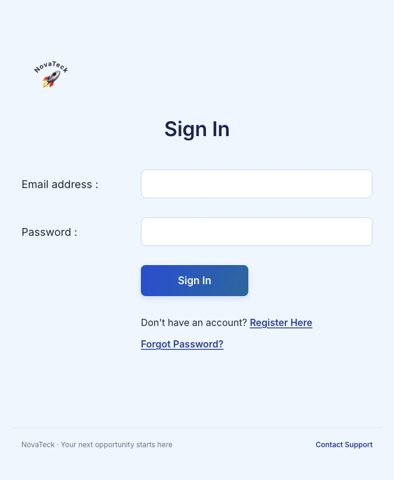

*Figure 1. Returning users enter their email and password.*

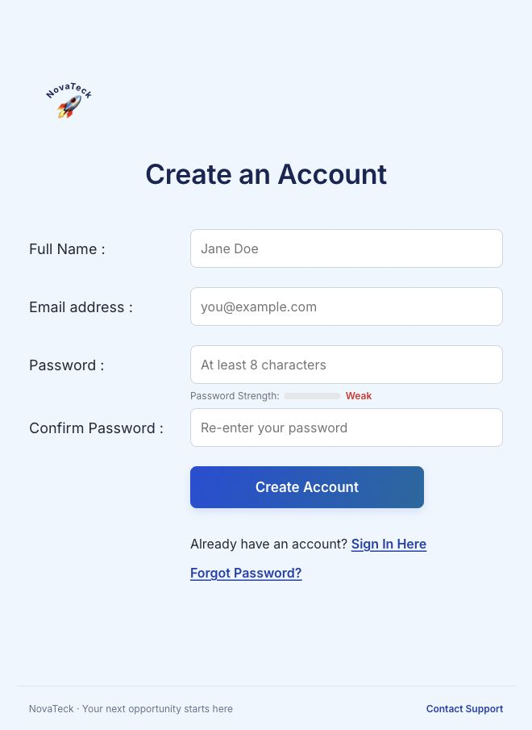

*Figure 2. New users complete the registration form.*

## 5. Features and Functions

### 5.1 Job search and applications

The **Jobs** page lets you narrow the available listings and examine employer requirements.

1. Enter a title, company, or keyword and select **Search**.
2. Select **Filters** to choose career categories, skills, experience level, location, or company. Select **Apply Filters** to update the results; selecting an option alone does not apply it.
3. Use **Sort by** to choose highest match or newest posted. Use **Next** and **Previous** for additional results.
4. Select a job title to read its description, required skills, preferred skills, and match details.
5. Select the bookmark control to save the job, or **Apply Now** to open the employer's posting in another tab.

**Example:** Search for `software`, filter for `Entry / intern`, and enter `Dallas` as the location. If results are too limited, select **Clear all** and start with fewer filters.

Applying happens on the employer's website. Opening that website does not mean you have completed or submitted an application. If the posting is unavailable, look for another active listing.

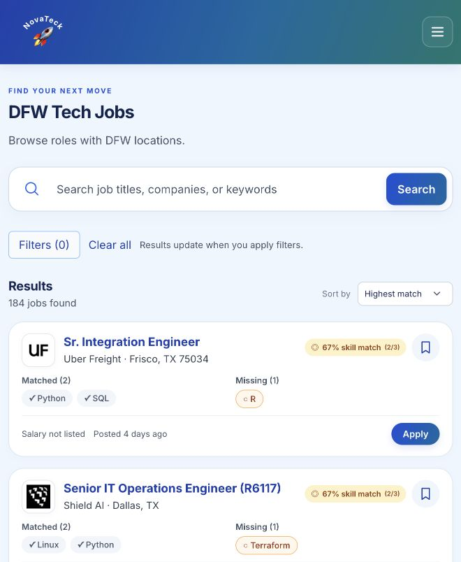

*Figure 3. Search results show separate matched and missing skills.*

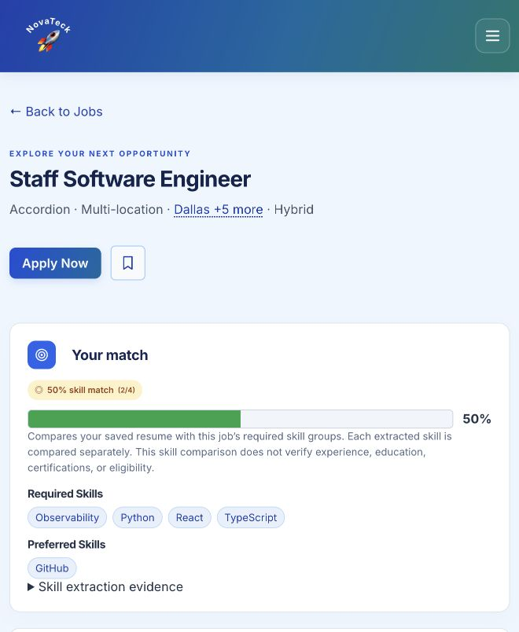

*Figure 4. Open a job to review its match and employer application link.*

### 5.2 Dashboard and reminders

Dashboard brings saved jobs, recommendations, and upcoming dates together.

1. Open **Dashboard** and review **Saved Jobs** or **Recommended Jobs**. Use **See all saved jobs** or **See all recommended jobs** for more results.
2. Open a listed job to review its current details. Use its bookmark control to change whether it is saved.
3. Review **Job alerts & reminders** for new matching opportunities and any available reminders. Open a job title to inspect it.

**Example:** Save a promising internship, then return to Dashboard to find it again and review new matching listings.

Alerts appear inside Dashboard; they are not emailed. New-job alerts use your profile skills and job preferences and require sufficient extracted skill requirements. An empty panel can mean there are no qualifying alerts yet.

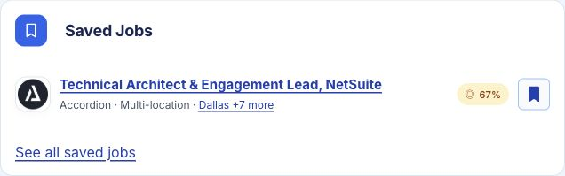

*Figure 5. Dashboard collects bookmarked opportunities.*

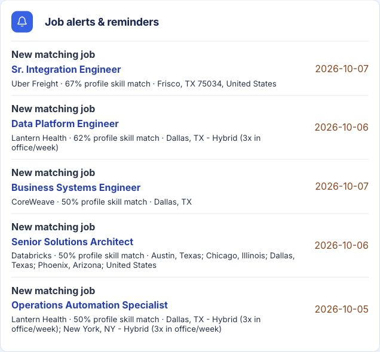

*Figure 6. Review new matching jobs and open their titles for details.*

### 5.3 Profile and preferences

Your profile stores the skills and preferences used for recommendations and market comparisons.

1. Open **Profile** and review your name, location, and other available fields.
2. Add skills and choose their proficiency levels. Add only skills that accurately describe your experience.
3. Review your career focus, preferred work types, and other job preferences.
4. Optionally upload a PNG or JPEG profile photo under 500 KB.
5. Select **Save Changes** and wait for the confirmation that your profile and skills were saved.

**Example:** Add `Python` and `SQL`, choose your proficiency, and select `Internship` as a preferred work type. Save before navigating away.

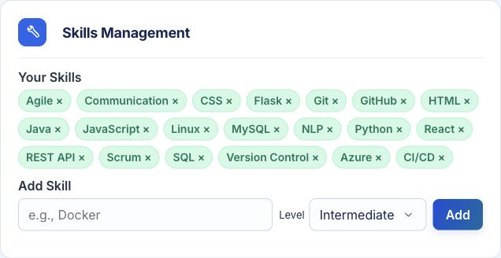

*Figure 7. Add individual skills and select a proficiency level.*

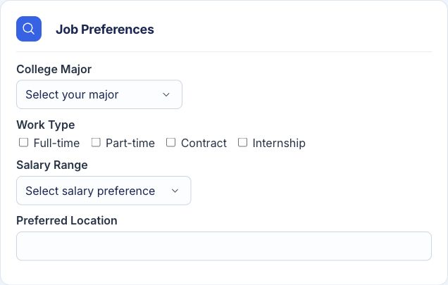

*Figure 8. Choose your major, work types, salary preference, and preferred location.*

### 5.4 Resume upload and skill detection

Resume Skill Detection identifies skills in your resume and saves the latest valid document for future preview and rescanning.

1. Open **Skill Gap** and locate **Resume Skill Detection**.
2. Browse for one PDF or DOCX file up to 5 MB, or drag it into the upload area.
3. Select **Scan Resume for Skills** and wait for processing to finish.
4. Review the detected skills. Select **Preview** to inspect the saved document; a DOCX preview shows text and may differ from the original formatting.
5. To scan again, use the saved resume without another upload. To replace it, choose a new file and scan it.
6. Review the suggested skills, select those you want in your profile, and use **Add selected**. You can also **Dismiss** an irrelevant suggestion and use **Undo** immediately afterward.

Skill extraction reads the full resume and sends its text to Google Gemini. Use only a document you are comfortable processing through that service. Review every result; automated extraction can miss or misidentify a skill.

In Profile, selecting a resume in the upload area saves and scans it automatically. A valid replacement overwrites the previous resume; an invalid upload preserves it. Extracted plain text is not stored separately.

**Example:** Upload a resume mentioning Python and Git. Review the detected names before adding them to your profile. Uploading alone does not add every detected skill to your saved profile.

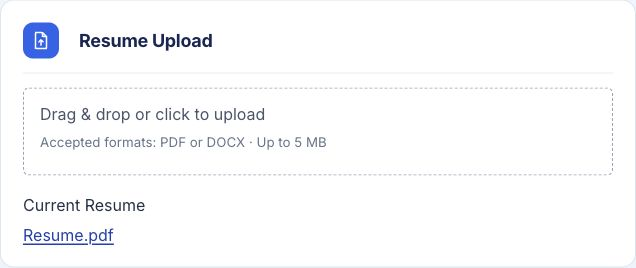

*Figure 9. Upload or replace a PDF or DOCX resume in Profile.*

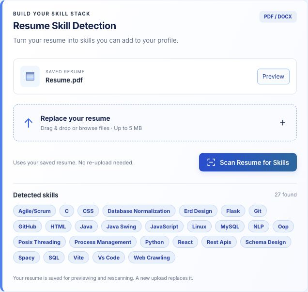

*Figure 10. Review detected skills and use Preview or Scan Resume for Skills.*

### 5.5 Skill gap analysis and market insights

Skill Gap helps you compare your profile with skills requested by employers and inspect a specific target job.

1. Open **Skill Gap** and choose the career category you want to explore.
2. Review **Your Skills**, **Market skill match**, and **Skills Gap**. The market percentage uses your profile skills, with more frequently requested skills contributing more.
3. Use the missing skills as a learning plan. Select **Add** only after you can confidently use a skill, or update your skills through Profile.
4. Review **Learning Recommendations** for resources related to missing skills, or select **Ask Nova for a learning plan**.
5. Open a job from **Jobs** to examine its required and preferred skills and supporting evidence.
6. Select **Export Report** to download a text summary of the category comparison.

**Example:** If a target job requests Python and SQL but your profile contains only Python, use SQL as a possible learning priority. Add SQL after learning it, then review the updated comparison.

The extractor reads the full job description and separates required skills from preferred skills using the employer’s wording. Open **Skill extraction evidence** on a job detail page to see supporting text. Distinct skills such as React and TypeScript are compared separately. Preferred skills are displayed separately and are not counted as required skills in the job match percentage. A posting marked **Skill analysis pending** does not yet have a verified analysis; wait for the operator to finish it.

Job cards use your saved resume when available and otherwise use profile skills. Their percentages can differ from the market comparison. Skill scores measure extracted skills rather than every job qualification, years of experience, or likelihood of being hired. A listing with fewer than three extracted requirements has too little information for a reliable overall fit score. Missing salary data appears as unavailable.

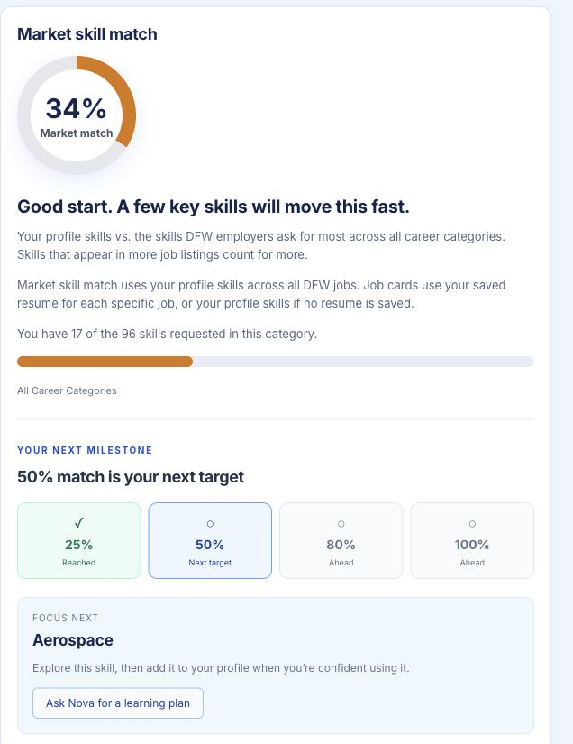

*Figure 11. Review the category match, next milestone, and suggested learning focus.*

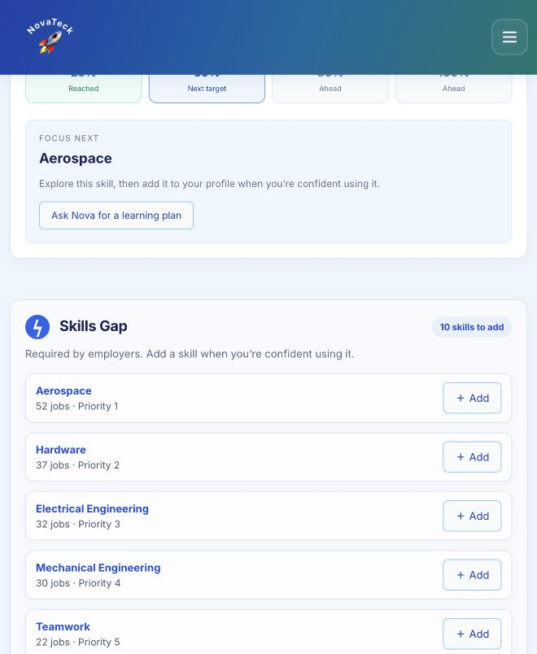

*Figure 12. Review missing skills and how many jobs request each one.*

### 5.6 Nova AI career chat

Nova AI can help you plan learning, practice interview questions, and improve resume wording when the operator has configured the service.

1. Sign in and select **Chat with Nova AI**.
2. Choose a suggested prompt or type a question under **Ask Nova**.
3. Select **Send message** and review the response.
4. Continue with a follow-up question, or select **Clear chat** to start again.

**Example:** Ask, “Help me plan four weeks of SQL practice for an entry-level data role,” or “Ask me a Python interview question.”

Messages are sent to Google Gemini. Your profile and resume are not attached automatically. Avoid entering passwords or sensitive information. Chat history clears on reload or logout. If the service is not configured, use the other application features and ask the operator about availability.

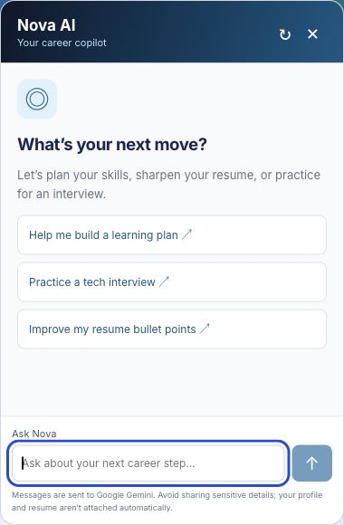

*Figure 13. Open Nova to choose a suggested career question.*

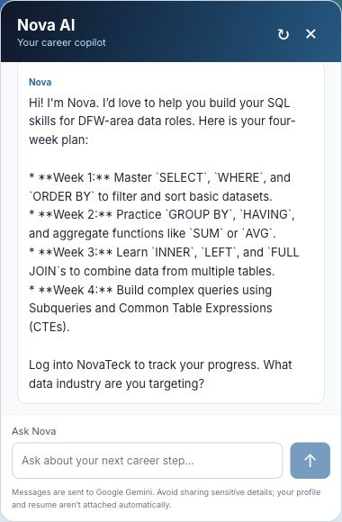

*Figure 14. Nova responds to a submitted sample question with a four-week SQL learning plan.*

### 5.7 Support requests

1. Select **Contact Support** in the footer or Profile's **Account Settings**.
2. Enter a short subject and describe what happened, the steps you took, and the error shown.
3. Select **Send Request** and note the displayed request number.
4. Open **My Support Requests** and select **Refresh** to see status changes and replies.

**Example:** Use the subject “Resume scan error” and explain the file format, approximate size, and exact error. Leave out passwords and sensitive resume contents.

Requests go to the application's support inbox. You must be signed in to submit or view them; submission does not send an email.

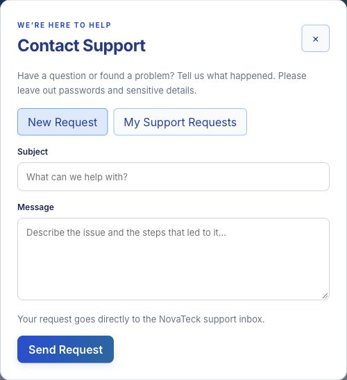

*Figure 15. Enter a subject and message, then select Send Request.*

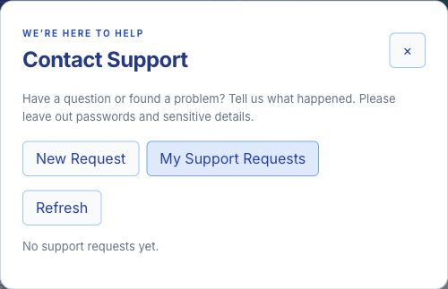

*Figure 16. Use My Support Requests and Refresh to review replies. This demo account has no requests yet.*

### 5.8 Administrator review

This feature applies only to designated administrators. Students do not need administrator access to use NovaTeck or add detected skills to their own profiles.

1. Open **Admin** and locate **Flagged Skills Review**.
2. Select **Load / Refresh Queue** to load pending submissions.
3. Review the skill name, submitting user, and date. Select **Approve** to accept the skill into the shared catalog if needed, or **Reject** to record a rejection.
4. Verify that the reviewed row leaves the pending queue.
5. Open **Support Inbox** to review requests and use the available reply and status controls to help users.

**Example:** Approve a valid technology skill after checking its name. Reject an item that is not a skill. Catalog approval does not automatically add the skill to a student's profile or change that student's profile match.

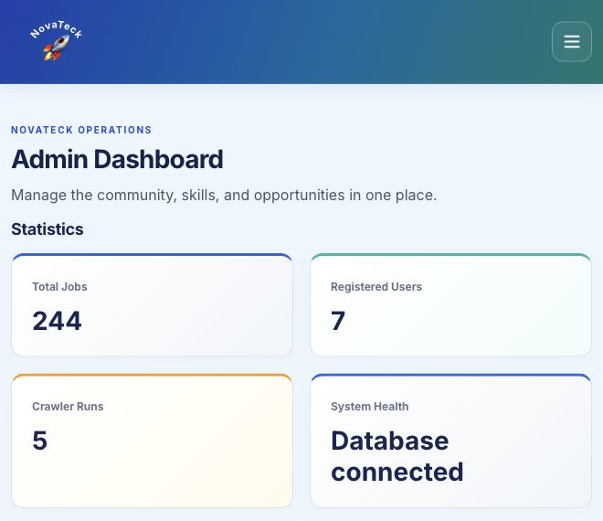

*Figure 17. Admin statistics summarize stored jobs, users, crawler runs, and database health. Counts change as the data changes.*

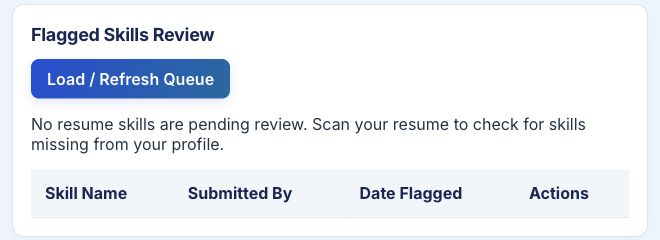

*Figure 18. The skill review queue displays pending submissions, or an empty-state message.*

## 6. Troubleshooting

| Problem | Likely cause | What to do |
| --- | --- | --- |
| The local page will not open | The browser interface is stopped, or the local address is being opened on a different device. | Ask the operator to start both app services. Open `http://127.0.0.1:3000` on the computer running them. |
| The page opens but data cannot load | The application service or database is unavailable. | Refresh once. If the error persists, ask the operator to check the service and MySQL connection. |
| Sign-in fails | Incorrect email or password, or an expired session. | Check the email spelling and sign in again. Use **Forgot Password?** if you cannot remember the password. |
| Password reset email does not arrive | The email is in spam, or the operator has not configured email delivery. | Check spam and verify the address. Ask the operator for help if reset is unavailable. |
| Resume upload is rejected | The file is too large, unsupported, encrypted, corrupt, or contains only images. | Choose a text-based PDF or DOCX up to 5 MB. Export a fresh file from your document editor and retry. |
| Search returns no jobs | Filters are too restrictive or listings have not been imported. | Select **Clear all** and search broadly. Ask the operator to check imported listings if results remain empty. |
| A match percentage did not change after scanning | The market comparison uses saved profile skills; scanning alone does not add skills to that profile. | Review suggestions, add the appropriate skills, and reopen the comparison. |
| Jobs show Skill analysis pending | The description has not been analyzed successfully yet. | Ask the operator to complete the pending analysis. Do not interpret the absence of a score as a zero match. |
| Scheduled sync cannot connect to the database | The hosted database may be powered off or its connection settings may be wrong. | Ask the operator to check Aiven. If powered off, power it on, wait for Running, then retry the sync. |
| Nova AI is unavailable | The service is not configured or its request limit has been reached. | Retry later if prompted, or ask the operator to check configuration. |
| Administrator access is denied | The account does not have the administrator role. | Ask the operator to verify your role if you are a designated administrator, then sign in again. |

## 7. Contact Information

- **In-app support:** Select **Contact Support** in the footer or Profile. Use **My Support Requests** to view replies.
- **Project repository:** [CSCE 4901–4902 NovaTeck](https://github.com/CSCE4901/CSCE-4901-4902-NovaTeck).
- **Website:** A public URL is not available yet. The local demonstration address is [http://127.0.0.1:3000](http://127.0.0.1:3000) on the host computer.
- **Support email:** [novateck.support@gmail.com](mailto:novateck.support@gmail.com)
- **If you cannot sign in:** Email novateck.support@gmail.com, since in-app support requires you to be signed in.

Include your request number, browser, affected feature, exact error, and steps to reproduce the issue when following up. Do not share passwords.

## 8. Frequently Asked Questions

**Do I need to install NovaTeck on my own device?**  
No installation is needed to use a running web instance. Because there is no public deployment yet, the local demonstration requires the operator to set it up first.

**Does scanning a resume automatically update my profile?**  
No. It saves and scans the resume, then lets you choose which detected skills to add. Job-specific matches can use the saved resume, while the market comparison uses your profile skills.

**Do I need administrator approval to add a detected skill?**  
No. You can add detected skills to your profile yourself. Administrator review manages the shared skill catalog.

**Can I replace or rescan my saved resume?**  
Yes. Uploading and scanning a valid replacement overwrites the previous document. You can rescan the saved document without uploading it again.

**Does Apply Now submit an application?**  
No. It opens the employer's website. Follow that website's application steps and confirm submission there.

**Does a 100 percent match mean I meet every qualification?**  
No. It reflects extracted skill requirements, not all education, experience, eligibility, or other employer criteria. Read the full posting before applying.

**Will reminders arrive by email?**  
No. Job alerts and reminders appear in Dashboard. Return to the app to review them.

**Why does my DOCX preview look different?**  
It is a text preview. Open your original DOCX in a document editor to inspect its full formatting.
